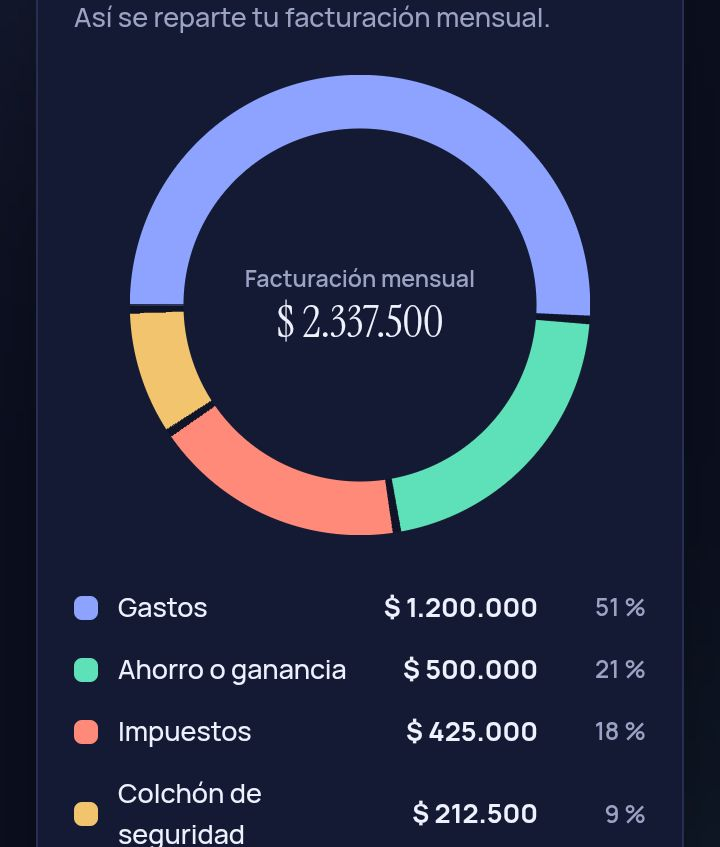

# Cuánto cobrar: calculadora de tarifas para freelancers

Una web app que le dice a un freelancer cuánto cobrar por hora, por día y por proyecto a partir de sus gastos reales, su tiempo disponible y lo que quiere ganar.

**[Probar la app en vivo](https://marina991.github.io/calculadora-tarifas/)**



## El problema

Muchos freelancers fijan sus precios mirando lo que cobra la competencia y se olvidan de lo básico: no todas las horas se facturan, hay impuestos, vacaciones y meses flojos. El resultado es cobrar de menos sin darse cuenta.

## Qué hace

- Guía en 4 pasos: gastos, tiempo, objetivo y resultado.
- Calcula la tarifa por hora, por día y por proyecto.
- Muestra a dónde va cada moneda que cobras: gastos, ahorro, impuestos y colchón de seguridad.
- Compara escenarios, como trabajar 5 horas menos o tomarte más vacaciones.
- Compara cobrar por hora con cobrar a precio cerrado.
- Permite copiar un resumen para guardarlo o compartirlo.
- Soporta ARS, USD, EUR, MXN, COP, CLP, BRL, UYU y GBP.
- Tiene modo claro y oscuro, y funciona bien en móvil.

## Cómo se calcula

```
Facturación mensual = (gastos + ahorro) / (1 - impuestos) × (1 + colchón)
Horas facturables al mes = horas por semana × (52 - semanas sin trabajar) / 12 × % facturable
Tarifa por hora = facturación mensual / horas facturables al mes
```

El precio cerrado de un proyecto suma un 20 % extra a la tarifa por hora para cubrir imprevistos.

## Decisiones de diseño

- **Una pregunta por pantalla:** reduce la fricción y evita abrumar a quien la usa.
- **Animaciones con propósito:** los números y el gráfico se animan para mostrar qué cambió cuando se ajusta un dato.
- **Sin fondo blanco:** paleta azul noche y gris azulado, con buen contraste en ambos modos.
- **Tipografía:** Instrument Serif para títulos y cifras, Manrope para el texto.

## Tecnologías

HTML, CSS y JavaScript puro en un solo archivo, sin dependencias ni proceso de compilación. Las tipografías se cargan desde Google Fonts.

## Cómo usarla en tu equipo

1. Descarga o clona este repositorio.
2. Abre `index.html` en tu navegador.

## Aviso

Es una estimación orientativa. Los impuestos y cargas cambian según el país y el régimen fiscal, así que ajusta el porcentaje a tu caso y consúltalo con un contador.

## Autor

Hecho por **Marina Mildemberger**. [LinkedIn](https://www.linkedin.com/in/marina-mildemberger)
